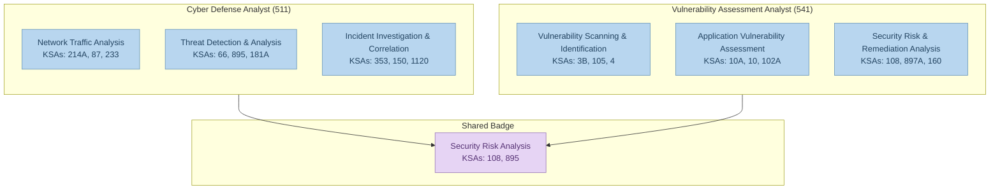
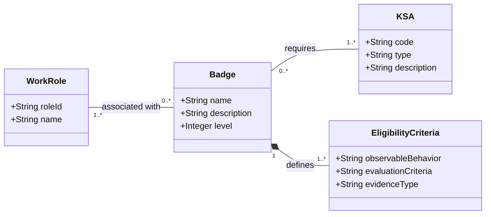
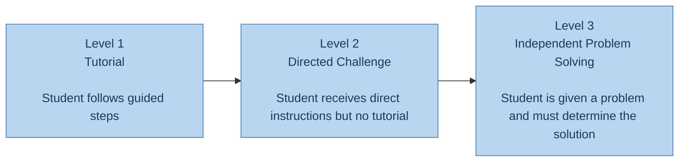
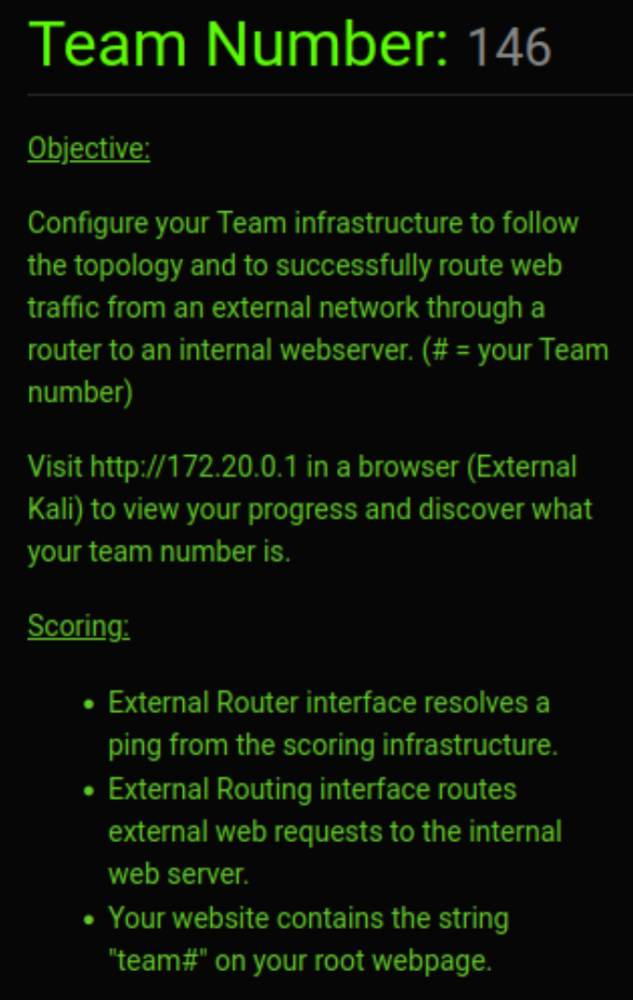
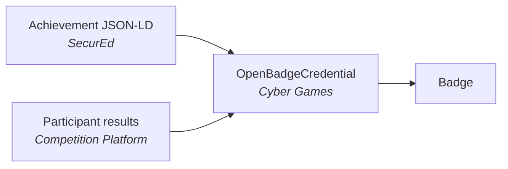
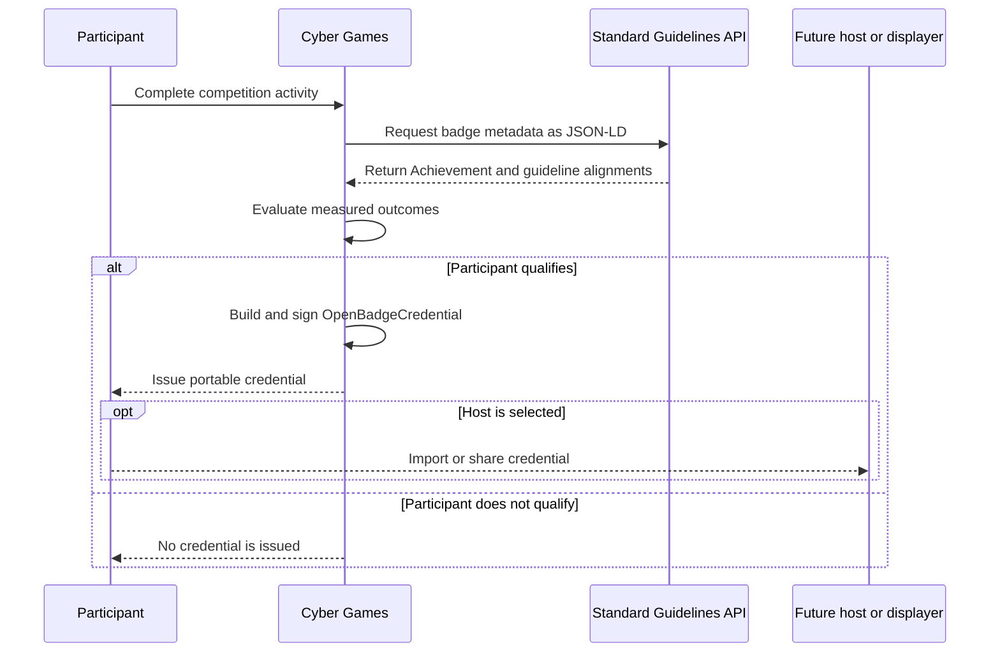
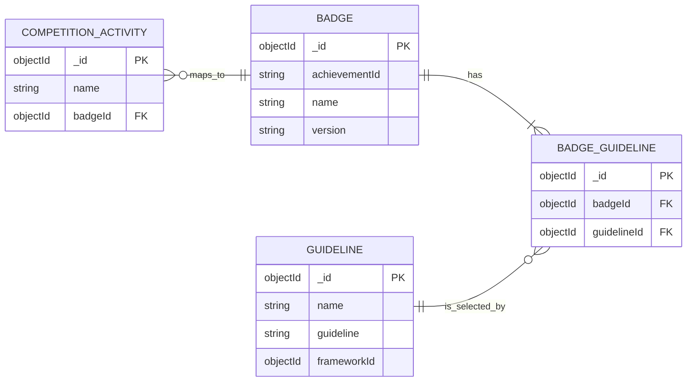

<!-- _class: lead -->

# Badging Framework

Draft Prototypes

---

<!-- _class: diagram -->
Proposed Badge Hierarchy


- Badges are a subset relevant KSAs
- Badges and work roles have a many to many relationship

---

<!-- _class: diagram -->



---

# Proposed Badge Levels

<!-- _class: diagram -->


---

# Missing Pieces

- Mapping between evidence and KSAs 
- What evidence is composed of


---

# Technical Section

---

# Open Badges 3.0 makes the credential portable

- The primary artifact is a signed verifiable credential expressed as JSON-LD.
- An achievement image is optional, so a badge can exist and travel without a PNG or SVG.
- Cryptographic evidence is added at issuance, while verification is performed later by a verifier or displayer.
- App wallets such as [Learner Credential Wallet](https://lcw.app/) can be used by participants to store their earned badges.
- Verification may still resolve the issuer public key and check current expiration or revocation status.

<!--
Sources:
https://www.imsglobal.org/spec/ob/v3p0/
https://www.imsglobal.org/spec/ob/v3p0/impl/
-->

---

# Responsibility boundary

- We name and describe each achievement in language that a learner and verifier can understand.
- We map observable competition activities to selected DCWF skill 
- We define thresholds, required evidence, badge levels, and versioning rules.
- We maintain DCWF guidelines.
- Cyber Games track performance, determine qualification, create the credential, and signs it.
- A future host stores, displays, shares, and verifies issued credentials when that role is assigned.

<!--
Source: Open Badges 3.0 distinguishes an Achievement creator from the credential issuer.
https://www.imsglobal.org/spec/ob/v3p0/#differentiating-issuers-and-achievement-creators
-->

---

# What we provide

- Each record should state human-readable earning criteria that match measurable competition outcomes.
- Each alignment should include a skill code, exact skill description, and framework name.
- JSON-LD is a natural interchange format because they can embed the Achievement in each issued credential.
- A public API that Cyber Games can reach out to before issuing and signing a badge. 

<!--
Source: Open Badges 3.0 Achievement, Criteria, and Alignment data models.
https://www.imsglobal.org/spec/ob/v3p0/#achievement
https://www.imsglobal.org/spec/ob/v3p0/#criteria
https://www.imsglobal.org/spec/ob/v3p0/#alignment
-->

---

# Minihack Tier 1 Example



<!--
Source: User-provided IMG_0425.jpeg showing the Minihack Tier 1 objective, topology, and scoring conditions.
-->

---

<!-- _class: jsonld -->

# JSON-LD makes guideline alignments portable

```json
{
  "@context": [
    "https://www.w3.org/ns/credentials/v2",
    "https://purl.imsglobal.org/spec/ob/v3p0/context-3.0.3.json"
  ],
  "id": "https://our-org.example/achievements/minihack-tier-1-routing",
  "type": ["Achievement"],
  "name": "Minihack Tier 1 — Network Routing and Configuration",
  "description": "Demonstrates foundational routing, subnetting, and network-segmentation skills in a scored competition environment.",
  "achievementType": "Badge",
  "humanCode": "MH-T1-NET",
  "version": "1.0.0",
  "creator": {
    "id": "https://our-org.example/profile",
    "type": ["Profile"],
    "name": "Our Organization"
  },
  "criteria": {
    "narrative": "Configure the team router so its external interface responds to scoring, external web requests reach the internal web server, and the required team identifier appears on the root webpage."
  },
  "alignment": [
    {
      "type": ["Alignment"],
      "targetCode": "S0035",
      "targetName": "Skill in establishing a routing schema",
      "targetFramework": "DoD Cyber Workforce Framework",
      "targetUrl": "https://standards.example.org/guidelines/S0035"
    },
    {
      "type": ["Alignment"],
      "targetCode": "S0162",
      "targetName": "Skill in sub-netting",
      "targetFramework": "DoD Cyber Workforce Framework",
      "targetUrl": "https://standards.example.org/guidelines/S0162"
    },
    {
      "type": ["Alignment"],
      "targetCode": "S0168",
      "targetName": "Skill in setting up physical or logical sub-networks that separate an internal LAN from other untrusted networks",
      "targetFramework": "DoD Cyber Workforce Framework",
      "targetUrl": "https://standards.example.org/guidelines/S0168"
    }
  ]
}
```

---

<!-- _class: diagram -->

# They turns our badging definition into a credential



- Cyber games adds recipient identity, issuance dates, evidence or results, issuer identity, schema references, and proof.
- The signed credential can embed our Achievement definition or preserve its stable identifier and agreed metadata.

<!--
Source: Open Badges 3.0 AchievementCredential and AchievementSubject data models.
https://www.imsglobal.org/spec/ob/v3p0/#achievementcredential
https://www.imsglobal.org/spec/ob/v3p0/#achievementsubject
-->

---

<!-- _class: diagram issuance -->

# Issuance



<!--
Source: Open Badges 3.0 verification and validation procedures.
https://www.imsglobal.org/spec/ob/v3p0/#verification-and-validation
-->

<!--
Source: Open Badges 3.0 data models, proof formats, and verification requirements.
https://www.imsglobal.org/spec/ob/v3p0/
-->

---

<!-- _class: diagram -->

# Standard guidelines database



---

<!-- _class: diagram -->

# Possible integrations with CLARK 

- **Learning-object showcase:** compare a badge's `badge_guidelines.guidelineId` values with the guideline IDs mapped to the learning object's outcomes; show the matching badge when their intersection is nonempty within the details page.
- **Browse filter:** when a user selects a badge, redirect to a CLARK browse page with at least one outcome mapped to one of that badge's guideline IDs.
